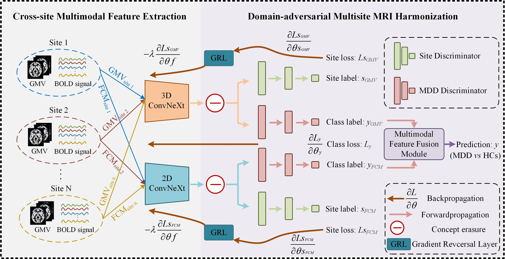

# DMH-Net: Domain-adversarial multisite harmonization network for major depressive disorder diagnosis
This repository contains the code and data for the paper "Domain-adversarial multisite harmonization network for major depressive disorder diagnosis". **The source code and in-house dataset will be made publicly available upon acceptance of the manuscript**.

# Summary
Major depressive disorder (MDD) is a highly heterogeneous psychiatric disorder, and the development of reliable objective diagnostic approaches remains a challenge. Although multimodal neuroimaging and deep learning have shown considerable potential for MDD diagnosis, substantial inter-site variability in multisite datasets remains a major barrier to model generalizability and clinical translation. To address this issue, we develop an end-to-end domain-adversarial multimodal MRI harmonization network (DMH-Net) for cross-site MDD diagnosis. Specifically, a dual-branch 2D/3D ConvNeXt encoder is employed to extract structural and functional representations from multimodal Magnetic Resonance Imaging, a least-squares concept erasure module and domain-adversarial harmonization learning strategy are designed to reduce site-related variations while preserving disease-relevant features, a product-of-experts fusion module is introduced to integrate modality-specific predictive distributions in the probabilistic space and output prediction. Finally, we evaluated DMH-Net on a large-scale multisite public dataset and an independent in-house cohort. Experimental results show that, compared with existing methods, DMH-Net effectively mitigates the site-shift effect and achieves the desired performance. Furthermore, the ‌t-distributed stochastic neighbor embedding visualization shows DMH-Net reduced site-dependent clustering after harmonization, and the Gradient-weighted Class Activation Mapping highlighted disease-relevant regions primarily within the prefrontal cortex and cerebellum. Collectively, these findings indicate that DMH-Net provides a transferable framework for MDD diagnosis across heterogeneous clinical sites. 

# Dataset
REST-meta-MDD consortium: https://rfmri.org/REST-meta-MDD.

The in-house dataset: **The in-house dataset will be made publicly available upon acceptance of the manuscript**.

# Requirements
The experiment codes of this study are compiled using PyTorch 1.13 and run on an NVIDIA L40 GPU.
